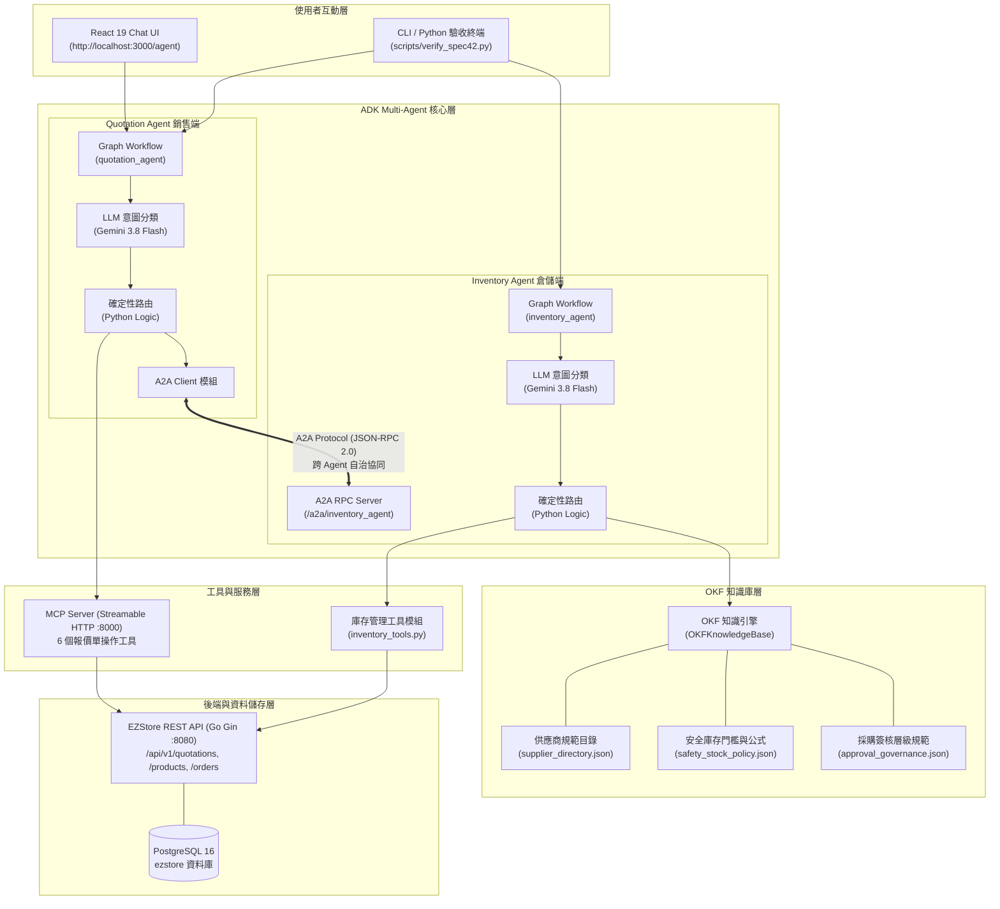
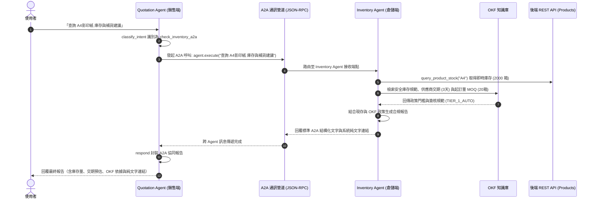
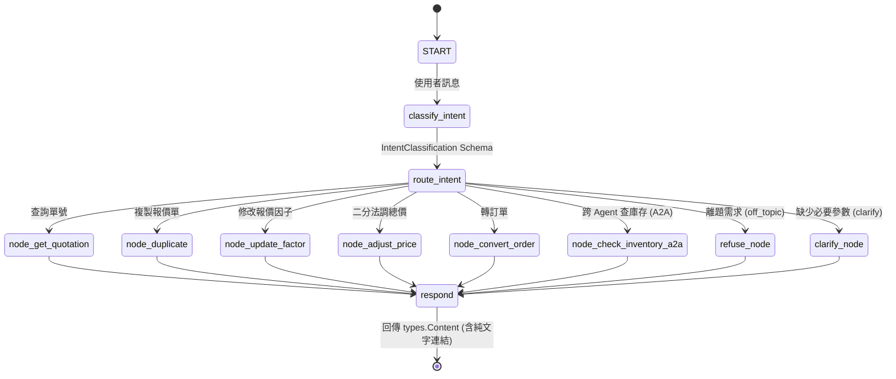
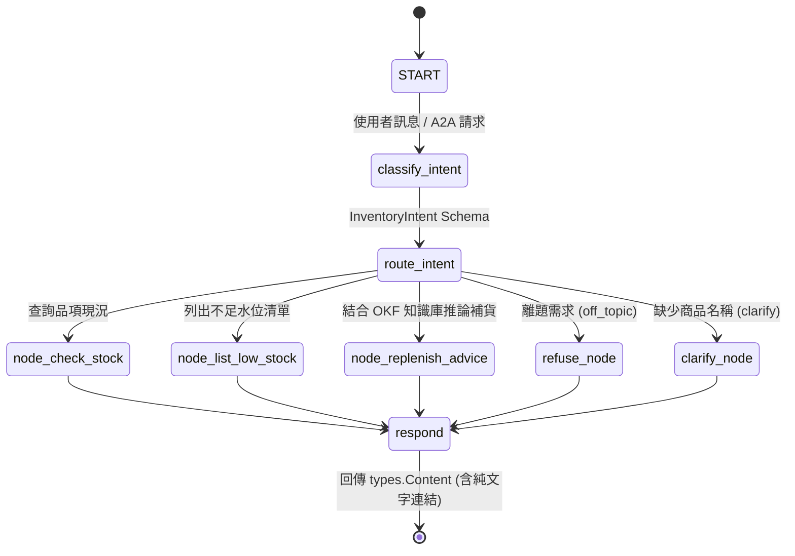

# EZStore 雙 Agent 協同架構規格書（A2A Protocol & OKF Knowledge Fabric）

本文件完整記述 EZStore 多 Agent 協同系統架構，包含：
1. **報價單管理 Agent (`quotation_agent`)**：負責客戶銷售端之報價單查詢、複製、調價、轉訂單。
2. **智慧庫存與補貨 Agent (`inventory_agent`)**：負責倉儲水位監控、安全存量評估與採購補貨建議。
3. **A2A (Agent-to-Agent) 通訊協定**：兩大獨立 Agent 間之跨領域自治協同機制。
4. **OKF (Open Knowledge Fabric) 知識庫**：為 Agent 提供企業採購規範、起訂量 (MOQ)、交期與金額審批層級之結構化知識支援。

---

## 1. 系統整體架構全景圖



---

## 2. A2A (Agent-to-Agent) 協同通訊架構

A2A 協定採用標準 **JSON-RPC 2.0** 與 **Agent Card** 發現機制，確保兩個 Agent 各自擁有清晰的領域邊界（Domain Separation），同時在需要跨領域業務時無縫協作。

### A2A 跨 Agent 循序圖（銷售報價 ──► 倉儲庫存與交期）



---

## 3. OKF (Open Knowledge Fabric) 知識庫設計

OKF 知識庫將原本寫死在業務代碼中的「商業規則」抽離為結構化的知識實體，由 `OKFKnowledgeBase` 引擎提供推論與合規校驗：

```
agent/inventory_agent/okf/
├── kb.py                    # OKF 知識檢索與推論核心引擎
├── supplier_directory.json  # 供應商名錄、前置交期 (Lead Time)、起訂量 (MOQ)、批次折扣
├── safety_stock_policy.json # 各品類最低安全存量標準、斷貨風險等級 (Risk Level)
└── approval_governance.json # 採購金額審批層級 (TIER_1_AUTO, TIER_2_MANAGER, TIER_3_EXECUTIVE)
```

### OKF 補貨決策推論邏輯矩陣

| 評估維度 | 輸入參數 | OKF 知識規則處理 | 輸出結果 |
|---|---|---|---|
| **最低安全存量** | 商品類別: 辦公用紙 | `category_policies["辦公用紙"].threshold = 15` | 現有庫存 < 15 時標記為 HIGH 風險警示 |
| **起訂量規整 (MOQ)** | 原始需求量: 8 箱 | 查詢 `supplier_directory`: 大同紙業 MOQ = 20 箱 | 自動向上規整為 20 箱（`moq_applied=True`） |
| **批次階梯折扣** | 採購數量: 50 箱 | 命中 `volume_discounts` (≥50 箱折 5%) | 自動套用 5% 成本折減並計算總額 |
| **簽核治理階層** | 總採購金額: NT$ 7,600 | 命中 `TIER_1_AUTO` (≤ 10,000 元) | 判定為自動放行，不需人工主管簽核 |
| **高額簽核治理** | 總採購金額: NT$ 32,000 | 命中 `TIER_2_MANAGER` (> 10,000 元) | 標記「需採購經理線上簽核後方可下單」 |

---

## 4. 兩大 Agent 之 Graph Workflow 狀態圖

### 1. Quotation Agent 狀態流程圖



### 2. Inventory Agent 狀態流程圖



---

## 5. 驗證與展示執行指令

### 執行 A2A 跨 Agent 協同與 OKF 知識推論展示
```bash
uv --directory agent run python ../scripts/demo_a2a_and_inventory.py
```

### 執行 Inventory Agent 單元測試（涵蓋 OKF 規則與 MOQ 斷言）
```bash
uv --directory agent run pytest inventory_agent/tests/test_inventory_agent.py -v
```

### 啟動 Inventory Agent 本機獨立服務（支援 A2A 與 REST API）
```bash
uv --directory agent run python -m inventory_agent.fast_api_app
```

