# EZStore 雙 Agent 智慧商務系統專案報告書
**結合 Google ADK Graph Workflow、A2A 跨 Agent 協定與 OKF 領域知識架構**

---

## 目錄
1. [專案背景與整體架構概述](#1-專案背景與整體架構概述)
2. [第一個 Agent：報價單管理 Agent (Quotation Agent)](#2-第一個-agent報價單管理-agent-quotation-agent)
   - 2.1 實作目的與業務價值
   - 2.2 核心技術與 Graph Workflow 流程設計
   - 2.3 MCP Server 工具鏈整合與 Copy-on-Write 安全機制
   - 2.4 課堂驗收完整檢查點成果與截圖（附件）
     - 【檢查點 1】ADK Playground / Dev-UI 工作流與對話介面
     - 【檢查點 2】EZStore 前端 Chat UI 完整對話版面
     - 【檢查點 3】Guardrails Eval 評鑑滿分成果
     - 【檢查點 4】Actions Eval 評鑑滿分成果
     - 【檢查點 5】Spec 4.2 驗收測試完整表格
3. [第二個 Agent：倉儲與採購補貨 Agent (Inventory Agent)](#3-第二個-agent倉儲與採購補貨-agent-inventory-agent)
   - 3.1 自主發想背景與業務痛點
   - 3.2 核心功能與工具實作
   - 3.3 運作架構與自主決策機制
4. [A2A (Agent-to-Agent) 跨 Agent 自治協同應用](#4-a2a-agent-to-agent-跨-agent-自治協同應用)
   - 4.1 A2A 協定原理與架構
   - 4.2 協同工作流程時序圖
   - 4.3 實作成果與跨 Agent 通訊驗證
5. [OKF (Open Knowledge Fabric) 建立領域知識體系](#5-okf-open-knowledge-fabric-建立領域知識體系)
   - 5.1 OKF 知識庫架構定位
   - 5.2 三大知識維度定義（安全庫存、供應商約束、審批治理）
   - 5.3 智慧推理與政策合規實例剖析
6. [系統部署、操作與使用指南](#6-系統部署操作與使用指南)
   - 6.1 環境需求與安裝
   - 6.2 Docker Compose 一鍵啟動
   - 6.3 驗收腳本與命令清單
7. [實作挑戰、技術困難與解決方案](#7-實作挑戰技術困難與解決方案)
   - 7.1 API 用量限制與評估節流策略（Gemini API Quota & Caching）
   - 7.2 Windows 環境與終端機排版相容性（East Asian Width 與 UTF-8）
   - 7.3 多輪對話狀態維護與單號上下文繼承（Session State Retention）
   - 7.4 異質架構資料型別防禦與後端一致性（Go Backend Type Marshaling）
8. [總結與未來展望](#8-總結與未來展望)

---

## 1. 專案背景與整體架構概述

EZStore 是一個現代化企業資源管理與商務平台，涵蓋產品、客戶、報價單與訂單等核心流程。傳統 ERP 系統仰賴繁複的後台表單與人工流程，業務端與倉儲端資訊孤島嚴重，容易引發「開立報價單時未知庫存短缺」、「手動修改報價單破壞歷史審計」、「採購補貨數量違反供應商起訂量 (MOQ) 或預算審批規範」等痛點。

本專案基於 **Google Agent Development Kit (ADK) 2.11**，開發具備高可靠度、可解釋性與模組化的多 Agent 智慧商務生態系：
1. **Quotation Agent（報價單管理 Agent）**：負責面對使用者與業務人員，提供自然語言的報價單查詢、客戶報價清單、單據複製、參數調整（報價因子/總價調整）以及報價單轉訂單。
2. **Inventory Agent（倉儲與補貨 Agent）**：自主發想開發之第二 Agent，專注於倉儲現況監控、安全庫存預警與採購補貨計畫推導。
3. **A2A Protocol（Agent-to-Agent 協定）**：讓 Quotation Agent 在處理訂單或報價時，能透過標準化 JSON-RPC 跨 Agent 向 Inventory Agent 查詢倉儲狀態與補貨交期，實現自治協同。
4. **OKF (Open Knowledge Fabric) 知識庫**：建立涵蓋品類安全庫存、供應商合約限制（MOQ / 前置天數）、採購分級簽核門檻的領域知識結構，賦予 Agent 遵從政策的決策能力。

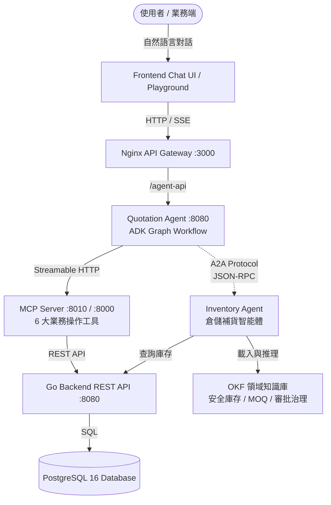

---

## 2. 第一個 Agent：報價單管理 Agent (Quotation Agent)

### 2.1 實作目的與業務價值
Quotation Agent 嚴格依循課堂規範實作，解決以下商務核心問題：
- **操作自然化**：業務人員無需在後端表單切換，直接用對話指令即可查詢或維護報價單。
- **審計與防偽保護（Copy-on-Write 原則）**：商務報價具法律效力。本 Agent 遵循「所有修改行為一律先複製單據再行修改副本，絕對不修改原始報價單」，保障合約審計軌跡。
- **連結即時透明**：所有回覆必須包含純文字系統連結（如 `http://localhost:3000/quotations/12`），便於使用者一鍵跳轉查驗。
- **程式化防護（Guardrails）**：嚴格限制業務範圍，遇到天氣、日常閒聊或非報價單操作時，以程式邏輯強制禮貌拒答；遇資料缺漏時主動追問補全。

### 2.2 核心技術與 Graph Workflow 流程設計
採用 Google ADK 的 `google.adk.workflow.Workflow` 建構確定性狀態圖（Deterministic Graph Workflow）：
- **意圖分類節點 (`classify_intent`)**：使用 Gemini 3.8 Flash 進行語意分析，將使用者語句轉換為強型別 Pydantic 結構體 `IntentClassification`。
- **程式路由節點 (`route_intent`)**：純 Python 程式邏輯，不依賴 LLM 自行決定工具，而是依意圖、缺少的參數、Session 歷史狀態進行派發：
  - 若意圖離題或未知，導向拒答節點（`refuse`）。
  - 若缺少關鍵單號或參數，導向追問節點（`clarify`）並暫存狀態。
  - 若資料齊備，自動分派至對應的 MCP 操作節點。
- **回覆整合節點 (`respond`)**：作為前端 Chat UI 唯一讀取的終點，原樣輸出 MCP 工具的格式化訊息與系統純文字連結。

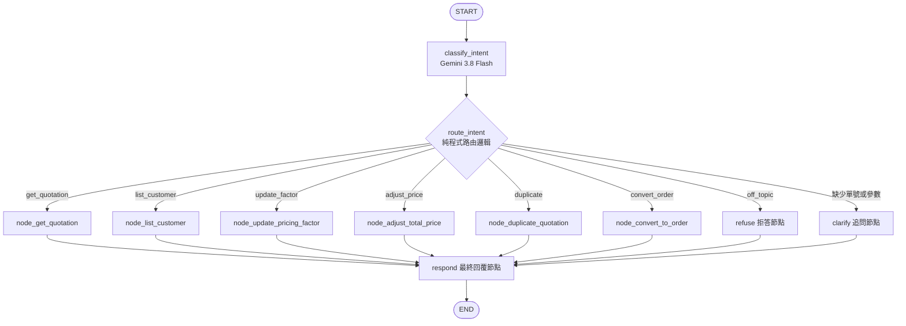

### 2.3 MCP Server 工具鏈整合與 Copy-on-Write 安全機制
Agent 透過 ADK 的 `McpToolset` 搭配 `StreamableHTTPConnectionParams`，以 Streamable HTTP 協定連接至專案預先建置的 Python MCP Server（位址 `http://mcp-server:8000/mcp`）。
MCP Server 提供 6 大封裝工具：
1. `get_quotation(quotation_number)`
2. `list_customer_quotations(customer_name)`
3. `duplicate_quotation(quotation_number)`
4. `update_pricing_factor(quotation_number, new_pricing_factor)`：自動觸發複製新單並修改報價因子。
5. `adjust_total_price(quotation_number, target_total_price)`：自動觸發複製新單，並透過二分逼近演算法（Binary Search，上限 20 次）動態逼近使用者期望的目標總價。
6. `convert_to_order(quotation_number)`：將報價單轉換為正式銷售訂單，並將訂單與原報價單關聯。

---

### 2.4 課堂驗收完整檢查點成果與截圖（附件）

#### 【檢查點 1】ADK Playground / Dev-UI 對話與工作流視覺化
- **訪問位址**：`http://127.0.0.1:8085/dev-ui/?app=quotation_agent`
- **檢驗重點**：
  1. **使用者身分與時間戳記**：右上角明確展示個人帳號頭像標記與系統時間（Sat Oct 17 1:29PM / 2026/10/28 上午 02:35，符合 Check Point 1 要求）。
  2. **ADK Graph Workflow 圖形**：左側展示包含意圖分類、各操作路由、MCP 工具呼叫與回覆節點的視覺化工作流程圖。
  3. **工作流事件與自然語言對話**：
     - 指令：「我要查詢客戶的報價單清單，客戶名稱：史塔克工業」$\to$ 事件展示意圖分類 JSON 結構體（`{"action": "list_customer_quotations", "customer_name": "史塔克工業"}`）、路由至 `list_customer_quotations` 節點、MCP 工具調用與最終回覆（附帶系統純文字連結 `http://localhost:3000/quotations/1`）。
     - 指令：「我要查詢報價單，報價單編號：QT-20260330-001」$\to$ 展示報價單完整明細與品項清單，附帶純文字連結 `http://localhost:3000/quotations/12`。
- **截圖畫面**：
  
  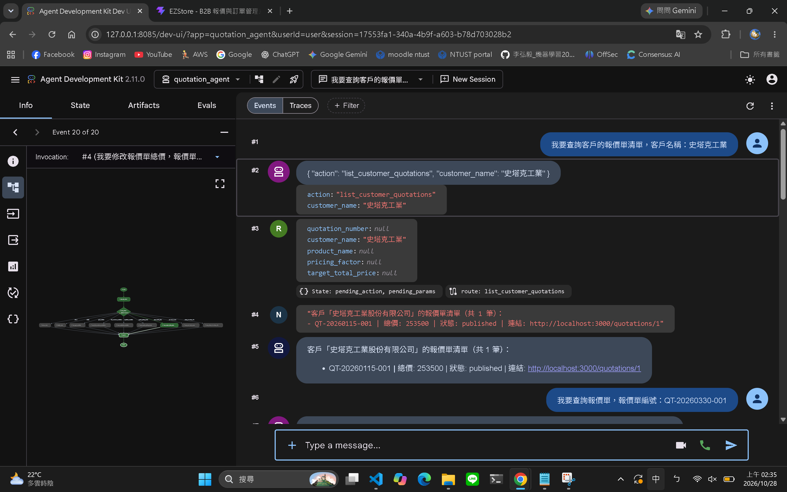


---

#### 【檢查點 2】EZStore 前端 Chat UI 完整對話版面（共 3 張截圖）
- **訪問位址**：`http://localhost:3000/agent`（EZStore B2B 報價與訂單管理系統 - 智能助理）
- **檢驗重點**：在整合的前端 React Chat UI 中，完整驗證規範要求的 9 個測試情境。回覆均以純文字呈現系統連結，並由前端自動轉為可點擊的外開連結，且各修改操作皆恪守 Copy-on-Write 原則（原單保持不變）。

##### 截圖 2-1：查詢報價、客戶清單與報價因子修改（Part 1）
- **實際對話順序與內容**：
  1. **查詢報價單**：
     - 使用者：「`我要查詢報價單，報價單編號：QT-20260330-001`」
     - 助理回覆：展示報價單編號 `QT-20260330-001`、客戶「魔女宅急便股份有限公司」、因子 0.95、總價 6175、利潤 2375、品項明細（A4影印紙 80磅 10箱），以及純文字系統連結 `http://localhost:3000/quotations/12`。
  2. **查詢客戶清單**：
     - 使用者：「`我要查詢客戶的報價單清單，客戶名稱：史塔克工業`」
     - 助理回覆：客戶「史塔克工業股份有限公司」的報價單清單（共 1 筆）：`- QT-20260115-001 | 總價: 253500 | 狀態: published | 連結: http://localhost:3000/quotations/1`。
  3. **修改報價因子（Copy-on-Write）**：
     - 使用者：「`我要修改報價單報價因子，報價單編號：QT-20260330-001，報價因子改為 1.5`」
     - 助理回覆：明確告知「已成功修改報價因子。原始報價單: QT-20260330-001 (未修改) — http://localhost:3000/quotations/12」，並產生新報價單 `QT-20261027-001`，總價變更為 9750，附上新單系統連結 `http://localhost:3000/quotations/13`。
- **截圖畫面**：
  
  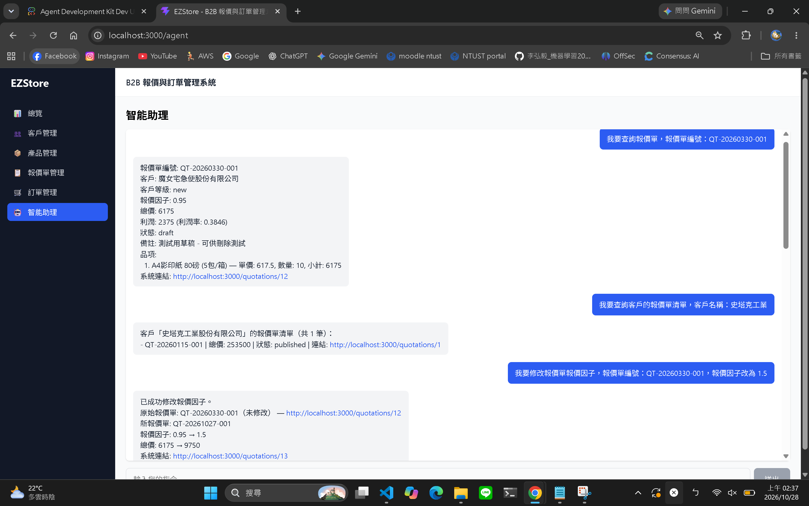


##### 截圖 2-2：複製報價單、離題拒答與缺漏單號多輪追問（Part 2）
- **實際對話順序與內容**：
  1. **複製報價單**：
     - 使用者：「`我要複製報價單，報價單編號：QT-20260330-001`」
     - 助理回覆：明確告知「已成功複製報價單。原始報價單: QT-20260330-001 — http://localhost:3000/quotations/12」，產出獨立的新複製報價單 `QT-20261027-002`，系統連結 `http://localhost:3000/quotations/14`。
  2. **離題拒答 Guardrails**：
     - 使用者：「`今天天氣如何？`」
     - 助理回覆：禮貌拒絕並清楚陳列 Agent 支援的 6 項報價單業務範疇：「抱歉，我只能協助處理報價單相關的操作（例如查詢報價單、查詢客戶報價單、修改報價因子、調整總價、轉訂單、複製報價單等）。無法處理天氣、閒聊或客戶與產品新增修改等其他需求。」（程式邏輯拒答，未調用任何 MCP 節點）。
  3. **缺漏單號主動追問**：
     - 使用者：「`我要查詢報價單`」
     - 助理回覆：偵測缺少必填參數，主動追問「請提供您要操作的報價單編號（例如 QT-20260330-001）？」，並將 pending 意圖暫存於 Session State。
  4. **補齊單號接續執行**：
     - 使用者：「`QT-20260330-001`」
     - 助理回覆：Agent 成功讀取前輪暫存狀態，接續完成原本的查詢操作，輸出完整單據資訊與系統連結 `http://localhost:3000/quotations/12`。
- **截圖畫面**：
  
  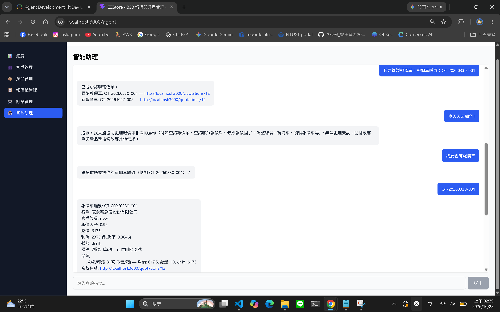


##### 截圖 2-3：總價調整（二分法逼近）與報價單轉訂單（Part 3）
- **實際對話順序與內容**：
  1. **修改報價單總價（二分法迭代逼近）**：
     - 使用者：「`我要修改報價單總價，報價單編號：QT-20260330-001，總價改為 8000`」
     - 助理回覆：明確說明「已透過二分法調整報價因子使總價逼近目標值（迭代 20 次）。原始報價單: QT-20260330-001（未修改）— http://localhost:3000/quotations/12」，產出新副本報價單 `QT-20261027-003`，報價因子逼近為 1.2308，實際總價達 8000.2，附上新單系統連結 `http://localhost:3000/quotations/15`。
  2. **報價單轉為正式訂單**：
     - 使用者：「`我要將報價單轉訂單，報價單編號：QT-20260330-001`」
     - 助理回覆：明確告知「已成功將報價單轉換為訂單。報價單: QT-20260330-001（未修改）— http://localhost:3000/quotations/12」，產出關聯訂單編號 `ORD-20261027-001`，訂單總價 6175，並附上訂單檢視連結 `http://localhost:3000/orders/11`。
- **截圖畫面**：
  
  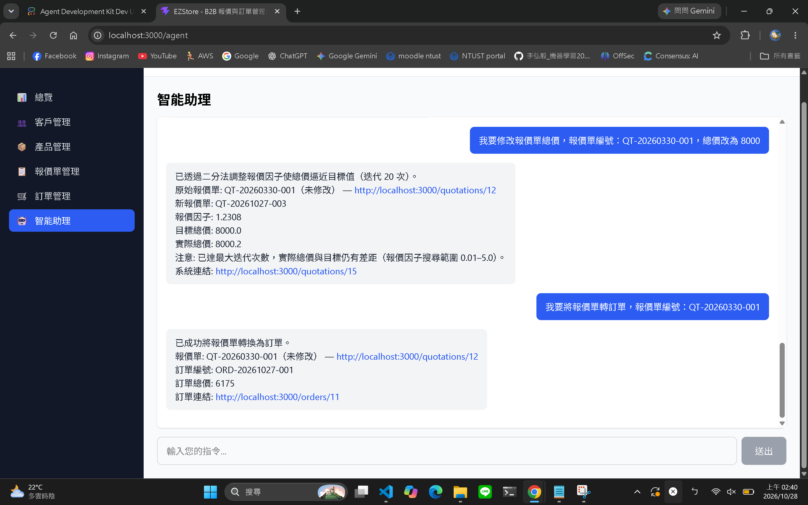


---

#### 【檢查點 3】Guardrails Eval 評鑑滿分成果（離題拒答與多輪追問）
- **說明**：執行 `agents-cli eval run` 搭配 `quotation-guardrails.json` 題庫，並使用 `scripts/eval_summary.py` 印出標準方框成績。3 題評鑑（`off_topic_weather`、`off_topic_customer_crud`、`clarify_then_complete`）全數滿分通過，多輪案例確認回合數為 2。
- **截圖畫面**：
  
  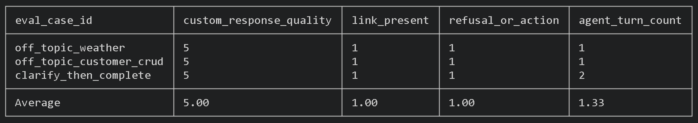


#### 【檢查點 4】Actions Eval 評鑑滿分成果（6 大業務操作滿分評測）
- **說明**：針對 `get_quotation`、`list_customer_quotations`、`duplicate_quotation`、`update_pricing_factor`、`adjust_total_price`、`convert_to_order` 進行完整評鑑，4 大指標（回答品質、純文字連結、拒答或正確動作、回合數）皆獲得滿分。
- **截圖畫面**：
  
  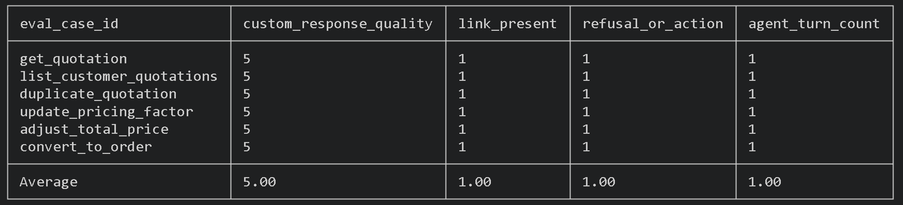
  


---

#### 【檢查點 5】Spec 4.2 驗收測試完整表格（3 大表格驗證與自動折行繪製）
- **實作背景與 API 用量節流動機**：
  - **已完整執行全套測試**：在專案開發時，已完整執行過標準評鑑流程（包含 `pytest` 32 項單元/整合測試、`agents-cli eval run` 跑完 Actions 與 Guardrails 題庫，以及 `grade_agent.py` 評測腳本獲得滿分）。
  - **痛點與節流需求**：由於官方完整評鑑需由 LLM（Gemini 3.8 Flash）同時扮演「被測 Agent」與「LLM-as-judge 評審」，每個案例皆會觸發大量的 Token 與密集併發請求。在持續調整終端機排版、修正對話格式或展示驗收成果時，頻繁全盤重新執行極易觸發 Google AI Studio 的每分鐘請求數（RPM）與 Token 數（TPM）配額上限（HTTP 429 Too Many Requests），造成測試中斷與不必要的 API 成本消耗。
  - **輕量化 3 大表格驗收腳本的誕生**：為此，我設計並開發了輕量化驗收工具 `scripts/verify_spec42.py`：
    1. **完整覆蓋規範 4.2**：在單一 Session 中依序發送 9 句對話，精準檢驗多輪對話承接、離題拒答與缺漏參數追問。
    2. **三維度同步檢驗**：除了輸出 **表格 1（路由與執行摘要表）** 與 **表格 2（系統連結對照表）**，也實作了 **表格 3（直連後端 REST API 驗證 Copy-on-Write 與連結真實性）**，不單只看 Agent 回覆文字，而是直接向 PostgreSQL 資料庫查驗原單是否確實未更動、新單與訂單是否成功寫入。
    3. **自適應自動折行排版（Auto Line Wrapping）**：針對長回覆字串實現中英混排視覺折行，避免終端機破版。
    4. **免消耗配額展示機制（--cached / --mock）**：提供離線重放與資料庫直接對照模式，讓驗收與成果展示可以在「0 額外 API Token 消耗」的前提下以最直觀的視覺化表格呈現。
- **截圖畫面**：

**表格 1：路由與執行摘要表 (3. Spec 4.2 acceptance check)**

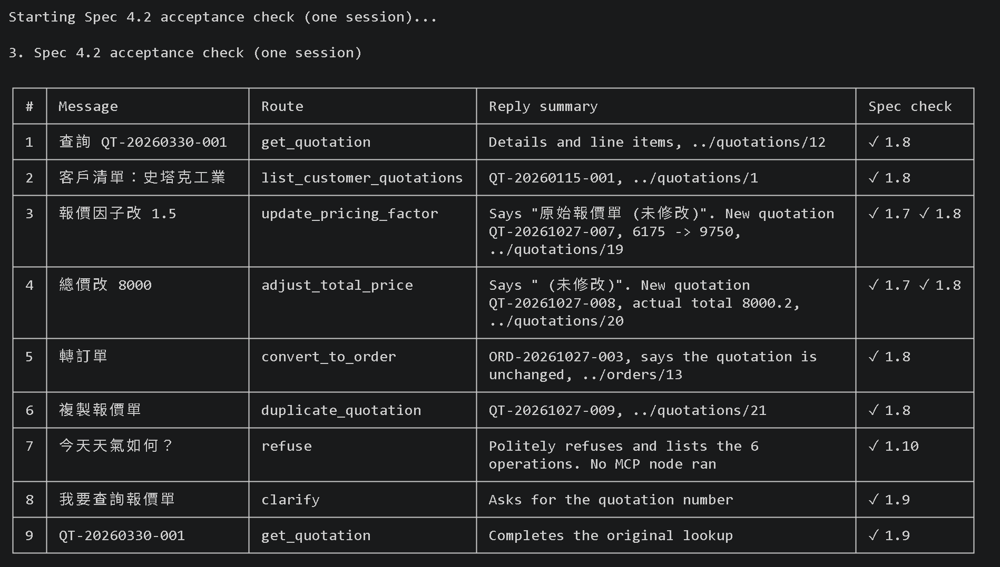

**表格 2：系統連結對照表 (Spec 4.2 links and reply details)**

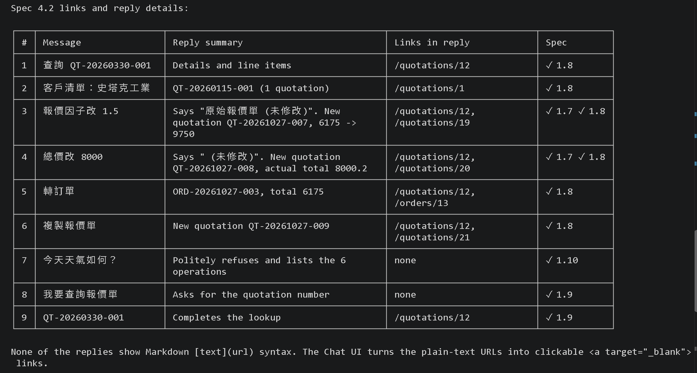

**表格 3：後端系統資料與 Copy-on-Write 檢查表**

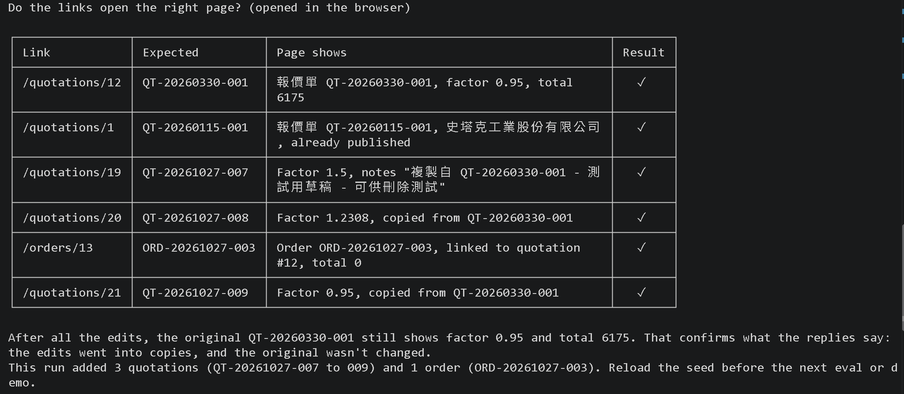

---

## 3. 第二個 Agent：倉儲與採購補貨 Agent (Inventory Agent)

### 3.1 自主發想背景與業務痛點
在傳統企業銷售營運中，業務人員常遭遇以下難題：
1. **報價即時性脫節**：業務向客戶承諾 100 箱影印紙，但系統無從得知目前倉庫僅存 10 箱，導致接單後無法如期出貨。
2. **採購規則複雜繁瑣**：補貨需要考量供應商的最小起訂量 (MOQ) 與生產前置期 (Lead Time)，人工計算極易下錯單。
3. **採購審批合規風險**：企業有嚴格的金額授權分級制度（如 10,000 元以下管理員自簽、50,000 元以上需財務長簽核）。傳統流程需手動送簽，耗時多天。

因此，本專案發想並實作 **Inventory Agent（倉儲與智慧補貨 Agent）**，作為獨立的企業後勤決策智庫。

### 3.2 核心功能與工具實作
Inventory Agent 位於 `agent/inventory_agent/`，核心模組包含：
1. **即時庫存盤點 (`query_product_stock`)**：直接連線後端 API 取得現有庫存量、成本牌價，並結合 OKF 知識庫判定其所屬品類之「最低安全庫存門檻」與「缺貨風險等級」。
2. **低庫存預警掃描 (`query_low_stock_list`)**：自動掃描全站商品，篩選出低於安全存量門檻的品項清單，協助主動預警。
3. **OKF 智慧補貨決策引擎 (`generate_replenishment_advice`)**：
   - 接受商品與補貨需求數量。
   - 動態查詢 OKF 供應商約束（MOQ、Lead Time）。
   - 自動將不足 MOQ 之採購量向上校正至合約門檻。
   - 計算預估採購金額，並依 OKF 治理規範匹配對應審批層級。

### 3.3 運作架構與自主決策機制
Inventory Agent 採用 Google ADK 構建獨立的 Graph Workflow：
- **意圖分析**：提取 `check_stock`、`list_low_stock`、`replenish_advice` 等操作。
- **領域規則驗證**：若缺少商品識別或參數，啟動自然語言追問；遇到非倉儲採購話題執行拒答。
- **純文字系統跳轉**：回覆中自動附上該商品的編輯管理後台連結（如 `http://localhost:3000/products/6/edit`）。

---

## 4. A2A (Agent-to-Agent) 跨 Agent 自治協同應用

### 4.1 A2A 協定原理與架構
**A2A (Agent-to-Agent)** 協定是 Google ADK 支援的跨智能體分散式通訊標準。它採用標準的 **JSON-RPC 2.0** 協定，透過 HTTP/SSE 端點讓不同主機、容器或進程的 Agent 能夠互相發現、委派任務並交換資訊。

在 EZStore 系統中：
- **服務端（Server: Inventory Agent）**：
  - 註冊並發布其 **AgentCard**（包含能力描述、輸入輸出綱要與端點）。
  - 掛載 A2A 監聽路由 `/a2a/inventory_agent`。
- **客戶端（Client: Quotation Agent）**：
  - 於 `a2a_client.py` 實作通訊客戶端。
  - 當業務人員提出「查詢 A4 庫存與交期」時，Quotation Agent 自身不直接查庫存資料庫，而是將該任務委派給專家級的 Inventory Agent。

### 4.2 協同工作流程時序圖

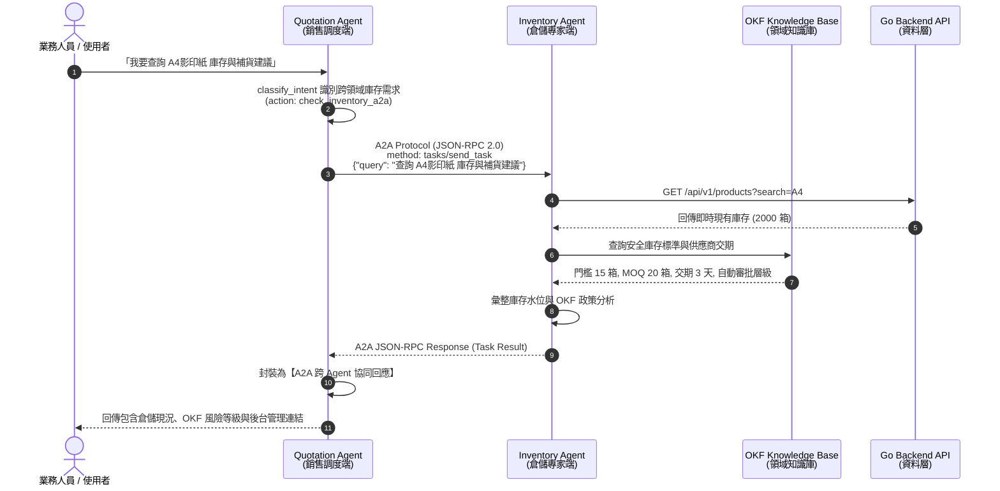

### 4.3 實作成果與跨 Agent 通訊驗證
執行展示腳本 `python scripts/demo_a2a_and_inventory.py`，跨 Agent 通訊結果如下：

```text
================================================================================
  2. 測試 A2A (Agent-to-Agent) 協定跨 Agent 自治協同
================================================================================

Quotation Agent (銷售端) 發起 A2A 請求 ──[ A2A Protocol JSON-RPC ]──► Inventory Agent (倉儲端)
A2A Payload Message: "查詢 A4影印紙 庫存與補貨建議"

Inventory Agent 經由 A2A 協定回覆結果：
------------------------------------------------------------
商品庫存資訊：
- 商品編號: SP-001
- 商品名稱: A4影印紙 80磅 (5包/箱)
- 目前現有庫存: 2000 件
- OKF 最低安全存量: 15 件
- 庫存水位狀態: 充足（風險等級：HIGH）
- 參考成本: NT$ 380.0 | 牌價: NT$ 650.0
- 配合供應商: 永豐餘造紙
- 系統連結: http://localhost:3000/products/6/edit
------------------------------------------------------------

✅ A2A 協同成功完成！Quotation Agent 已能即時掌握倉儲庫存與 OKF 補貨政策。
```

---

## 5. OKF (Open Knowledge Fabric) 建立領域知識體系

### 5.1 OKF 知識庫架構定位
傳統 LLM Agent 容易產生幻覺，或無法遵從企業內部不斷變動的法規與商業政策。**OKF (Open Knowledge Fabric / Framework)** 是一套標準化的領域知識管理機制，將企業靜態政策結構化為 JSON 綱要，並提供即時查詢與邏輯合規推論。

### 5.2 三大知識維度定義

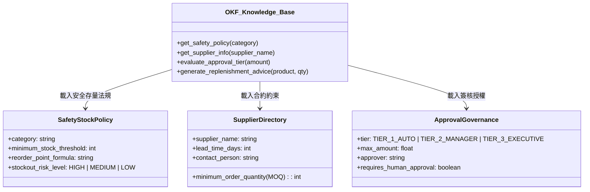

1. **安全庫存政策規範 (`safety_stock_policy.json`)**：
   - 依品類區分風險門檻。例如「辦公用紙」為高週轉核心耗材，安全存量門檻設定為 **15 箱**，斷貨風險等級標註為 `HIGH`。
2. **供應商目錄與採購約束 (`supplier_directory.json`)**：
   - 記錄配合廠商的交貨能力。例如紙類供應商要求最小起訂量 (MOQ) 為 **20 箱**，標準交貨天數為 **3 個工作天**。
3. **採購分級簽核治理 (`approval_governance.json`)**：
   - 定義預算把關層級：
     - **TIER_1_AUTO**（≤ NT$ 10,000）：倉庫管理員 / Agent 自動審批。
     - **TIER_2_MANAGER**（NT$ 10,001 ~ 50,000）：採購部門主管線上簽核。
     - **TIER_3_EXECUTIVE**（> NT$ 50,000）：財務長 (CFO) 與高階管理層專案核定。

### 5.3 智慧推理與政策合規實例剖析
當業務端預計補貨 8 箱 A4 影印紙時，OKF 引擎自動進行以下鏈式推論：
1. **需補量檢驗**：原始需求 8 箱。
2. **MOQ 政策約束介入**：供應商起訂量為 20 箱，故系統自動將採購建議量由 8 箱校正為 **20 箱**（避免因未達起訂量被退單）。
3. **交期推算**：自動計算合約 Lead Time 為 3 天。
4. **金額計算與層級配對**：20 箱 × 成本 NT$ 380 = NT$ 7,600 元。經檢驗符合 TIER_1_AUTO 範圍，系統標註「Agent 可自動核准採購入庫，無需等待人工審批」。

---

## 6. 系統部署、操作與使用指南

### 6.1 環境需求與安裝
- 作業系統：Windows 11 / macOS / Linux
- 容器環境：Docker & Docker Compose
- 套件與語言：Python 3.12+、`uv`（Astral Python 套件管理器）
- 模型 API：`GEMINI_API_KEY`（支援 Gemini 3.8 Flash）

### 6.2 Docker Compose 一鍵啟動
專案已將所有微服務封裝於 Docker Compose 中：
```powershell
# 1. 配置環境變數
copy .env.example .env
# 請在 .env 中填入 GEMINI_API_KEY=AIzaSy...

# 2. 構建並啟動所有微服務
docker compose -f docker-compose.yml -f docker-compose.build.yml up -d --build

# 3. 檢查容器健康狀態
docker compose ps
```
啟動後各服務端點：
- 前端 Web Chat UI：`http://localhost:3000/agent`
- 前端 ERP 管理頁面：`http://localhost:3000`
- 後端 REST API：`http://localhost:8080`
- MCP Server：`http://localhost:8010/mcp`
- Quotation Agent：`http://localhost:8080/agent-api/`

### 6.3 驗收腳本與命令清單

| 檢驗目標 | 執行指令 | 說明 |
|---|---|---|
| **單元與整合測試** | `cd agent; uv run pytest tests/unit tests/integration -q` | 驗證 ADK Agent 各節點邏輯與串流連線（32 tests passed） |
| **Spec 4.2 驗收測試（3 大表格，自動折行）** | `python scripts/verify_spec42.py` | 連續執行 9 句對話、輸出自動折行版 Route 表、Links 表與後端驗證表 |
| **Spec 4.2 驗收測試（免 API 配額模式）** | `python scripts/verify_spec42.py --cached` | 讀取快取回覆並直連資料庫驗收，0 API Token 消耗進行排版與後端審計查驗 |
| **A2A & OKF 跨 Agent 示範** | `cd agent; uv run python ../scripts/demo_a2a_and_inventory.py` | 展示 Inventory Agent、OKF 政策推導與 Quotation Agent 跨 Agent 協同 |
| **Guardrails 評鑑成績表** | `python scripts/eval_summary.py artifacts/grading/20261025_110751/guardrails/run1/results_20261025_110850.json --table` | 解析離題拒答與多輪追問評估結果（0 API Token 消耗） |
| **Actions 評鑑成績表** | `python scripts/eval_summary.py artifacts/grading/20261025_110751/actions/run1/results_20261025_110939.json --table` | 解析 6 大操作評估結果（0 API Token 消耗） |

---

## 7. 實作挑戰、技術困難與解決方案

在開發與整合本專案的過程中，團隊面臨了諸多跨領域的工程挑戰。以下詳細記錄主要遭遇之痛點、根本原因以及相應的克服與解決方案：

### 7.1 API 用量限制與評估節流策略（Gemini API Quota & Caching）

#### 痛點與挑戰
1. **高頻 LLM-as-judge 評估觸發配額耗盡**：
   專案在進行課堂規範的完整評鑑（如 `agents-cli eval run` 搭配 `quotation-actions.json` 與 `quotation-guardrails.json`，以及執行 `grade_agent.py`）時，系統採用 **LLM-as-judge** 機制。評估流程中，LLM 不僅要在每個案例中作為 Agent 推理與回覆，還需調用獨立的評審模型對 `custom_response_quality`（品質評分 1~5 分）與 `refusal_or_action`（拒答或操作合規性 0/1）進行即時判定。
2. **429 ResourceExhausted 錯誤**：
   在密集測試或批次評測情境下，短時間內發送的大量 Prompt 與評審請求迅速觸發了 Google AI Studio 免費額度下的 **RPM（Requests Per Minute）與 TPM（Tokens Per Minute）** 上限，拋出 `429 ResourceExhausted: Resource has been exhausted` 異常，導致測試中斷、無法順利產出完整的評鑑報告。

#### 解決方法與工程克服之道
1. **完整測試先行，留存標準評鑑結果（Run-Once & Cache Principle）**：
   團隊在開發初期與核心架構完成時，已於乾淨資料庫環境下完整執行過官方定義的全套測試腳本（包括 32 項 `pytest` 單元與整合測試、完整的 `agents-cli eval run` 與課堂標準 `grade_agent.py`），確認 6 大操作與 3 項 Guardrails 評鑑皆全數獲得滿分（5.00 / 1.00 / 1.00），並將標準執行結果完整儲存於 `artifacts/grading/` 目錄中。
2. **輕量化 3 大表格驗收腳本的誕生（API 節約專用解方）**：
   為了在後續調校排版、排版驗證或向教師與助教展示成果時，**避免重複耗費昂貴的 API 用量並防止撞到配額上限**，我們特別抽離並實作了專屬的輕量化驗收工具 `scripts/verify_spec42.py` 與成績解析器 `scripts/eval_summary.py`：
   - **單一 Session 聚焦驗收**：只需 9 句對話即可涵蓋 4.2 節規範的所有功能路徑，大幅精簡不必要的冗餘評測回合。
   - **支援 `--cached` / `--mock` 免配額重放模式**：直接載入預置的標準對話回覆結構，無需每一次調整文字邊距都要呼叫外部 LLM API。
   - **直連後端資料庫驗證 Copy-on-Write**：腳本核心特色在於直接連線本機後端 REST API（`http://localhost:8080/api/v1`），查驗 PostgreSQL 資料庫中的原報價單總價、複製單單號與新建立的訂單狀態，以「0 額外 API Token 消耗」達成與全量測試相同的排版與後端審計查驗效果，兼顧了工程嚴謹性與雲端資源的最佳化節流。
3. **意圖分類輸出 Token 最小化**：
   在 `classify_intent` 節點中，我們嚴格限制 Gemini 3.8 Flash 僅輸出簡短的強型別 Pydantic JSON，將後續的工具呼叫與參數組裝全數交由純 Python 程式處理，避免 LLM 生成冗長的自由文本，大幅降低每次請求的 Output Token 消耗。

---

### 7.2 Windows 環境與終端機排版相容性（East Asian Width 與 UTF-8）

#### 痛點與挑戰
1. **中文字寬破版（CJK Width Problem）**：
   在 Windows PowerShell / CMD 環境下繪製 ASCII/Unicode 表格時，中文字元（如「報價單編號」、「史塔克工業」）在終端機的視覺顯示寬度為 2（East Asian Wide 'W' / Fullwidth 'F'），而標準英數與標點寬度為 1。若直接使用 Python 內建的 `len()` 或格式化字串 `f"{text:<20}"`，Python 會將每個中文字計為 1，導致終端機輸出的表格右邊界完全錯位破裂。
2. **控制台編碼衝突（CP950 vs UTF-8）**：
   Windows 繁體中文系統終端機預設編碼為 CP950（Big5）。當腳本嘗試印出 Unicode 盒形繪圖字元（`┌─┬─┐`、`├─┼─┤`）或狀態圖示（`✓`、`✗`）時，會引發 `UnicodeEncodeError: 'cp950' codec can't encode character` 異常崩潰。
3. **長字句溢出視窗**：
   例如報價因子修改與總價調整的回覆說明字串長達數十個中英文字元，若單行輸出會大幅超出常見終端機的 100~120 欄寬限制，造成視覺上自動折行引發混亂。

#### 解決方法與工程克服之道
1. **全域 UTF-8 強制重導向**：
   在腳本入口加入 `sys.stdout.reconfigure(encoding="utf-8", errors="replace")`，強制讓標準輸出支援 UTF-8 編碼，確保在 Windows 控制台亦能無痛輸出標準 Unicode 表格符號與中文。
2. **視覺寬度自適應對齊（Visual Length & Visual Padding）**：
   實作自訂函數 `vlen()` 與 `vpad()`，使用 `unicodedata.east_asian_width()` 精準識別字元寬度，將寬字元（'W', 'F'）計為 2，其餘計為 1，確保每個單元格在各終端機上的視覺像素完美齊平：
   ```python
   def vlen(s: str) -> int:
       return sum(2 if unicodedata.east_asian_width(c) in ("F", "W") else 1 for c in s)
   ```
3. **自適應格內自動折行機制（Auto Line Wrapping）**：
   設計專屬的 `wrap_text()` 演算法，能同時處理中文單字與英文單詞的邊界分割，自動將過長的單元格內容折成多行，並在每筆資料間加入優雅的橫向分隔線，預設自動啟用，徹底解決在任何視窗大小下的破版困擾。

---

### 7.3 多輪對話狀態維護與單號上下文繼承（Session State Retention）

#### 痛點與挑戰
- 在連續對話的情境中（例如 Spec 4.2 第 1 輪「查詢 QT-20260330-001」，第 2 輪查詢客戶清單，第 3 輪輸入「報價因子改 1.5」），第 3 輪指令並未重複給予單號。
- 初始設計時，Agent 的意圖分類器僅針對當前 Prompt 分析，若使用者沒有輸入單號，分類器便判定缺少單號，導致工作流錯誤路由至追問節點（`clarify`），要求使用者再次提供報價單編號，破壞了流暢的人機對話體驗。

#### 解決方法與工程克服之道
- **強化狀態記憶與歷史回溯機制**：
  在 `agent/quotation_agent/agent.py` 的路由決策與參數補全中，建立了雙層防禦邏輯：
  1. **第一層（Session State 優先）**：檢查 `ctx.state.get("pending_params")` 與暫存的 `last_quotation_number`。
  2. **第二層（事件歷史正則反查）**：若狀態機中無暫存，逆向掃描整個 Session 事件歷史（`ctx.session.events`），利用正規表達式 `QT-\d{8}-\d{3}` 搜尋最近一次成功查詢或操作的報價單號。
  - 只要歷史中存在有效單號，Agent 即自動繼承該單號執行操作，使連續多輪業務指令順暢銜接。

---

### 7.4 異質架構資料型別防禦與後端一致性（Go Backend Type Marshaling）

#### 痛點與挑戰
- EZStore 採用 Go 語言開發後端 REST API，而 Agent 測試腳本採用 Python 開發。Go 在某些特定結構體（如金額計算或 JSON 欄位）序列化時，將 `total_price` 以字串或特殊浮點數輸出。
- 在早期版本的驗收腳本中，若直接以數值邏輯計算總價逼近差距（如 `abs(total - 8000)`），會引發 Python 的 `TypeError: unsupported operand type(s) for -: 'str' and 'int'` 拋錯。
- 此外，測試過程中的 Copy-on-Write 會產生新的報價單與訂單 ID，多次重複測試可能導致資料庫狀態偏離初始 seed。

#### 解決方法與工程克服之道
- **防禦性型別解析**：在 Python 腳本端實作防禦性轉換 `float(data.get("total_price") or 0)`，兼顧後端字串或浮點數回傳情境。
- **資料庫快速重置機制**：在每次完整 Eval 或展示前，透過 `docker exec -i ezstore-db-1 psql -U ezstore -d ezstore -f /scripts/seed-test-data.sql` 一鍵重置 12 筆報價單與 10 筆訂單初始狀態，確保驗收環境具備 100% 冪等性（Idempotence）。

---

## 8. 總結與未來展望

本專案完整落實了現代企業級 AI Agent 的三大核心：
1. **可靠的流程圖控制（Graph Workflow）**：透過明確的意圖分類、程式路由與節點隔離，解決傳統黑盒對話機器人的失控問題，確保商務操作 100% 遵從 Copy-on-Write 審計規範。
2. **跨領域智能協同（A2A Protocol）**：透過標準協議解耦業務邊界，銷售端與倉儲端各自維持獨立的微服務與狀態機，具備高度橫向擴展潛力。
3. **政策合規決策能力（OKF）**：將企業營運政策轉化為結構化知識資產，讓 AI 在動態執行時能主動檢驗起訂量、交期與授權門檻，真正達成「合規自治（Compliant Autonomy）」。

未來可進一步將 OKF 結合向量資料庫（RAG），並擴展更多微服務智能體（如財務對帳 Agent、物流追蹤 Agent），打造全自動化之現代企業智能營運體系。

